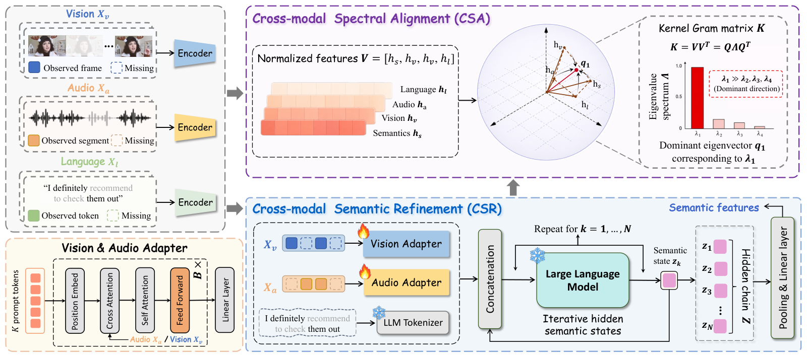

<div align="center">

# SemMSA: Latent Semantic-Aided Robust Multimodal Sentiment Analysis with Incomplete Data

**Wenhao Li**<sup>1,2</sup>, **Zhibin Wu**<sup>1</sup>, **Chong Xiao**<sup>1</sup>, **Qiangchang Wang**<sup>1,*</sup>

<sup>1</sup>School of Software, Shandong University &nbsp;&nbsp; <sup>2</sup>Shenzhen Loop Area Institute &nbsp;&nbsp; <sup>*</sup>Corresponding author

[](https://arxiv.org/abs/2609.30238)
[](https://peacelwh.github.io/SemMSA/)
[](https://huggingface.co/datasets/Bluexxx/SemMSA-data)
[](https://huggingface.co/Bluexxx/SemMSA)
[](LICENSE)

</div>

## Overview

Recent research on Multimodal Sentiment Analysis (MSA) has focused on learning from language, visual, and acoustic
modalities with incomplete data to infer human sentiment. Most studies compensate for missing information by
reconstructing modality features or designing complicated fusion mechanisms, and therefore still suffer from spurious
generation and noisy guidance due to the lack of high-level semantic grounding in partially observed multimodal evidence.

**SemMSA** is a latent semantic-aided framework that constructs rich sentiment-relevant semantics with LLMs and fully
integrates them with all modalities via anchor-free spectral alignment. It consists of two components:

- **Cross-modal Semantic Refinement (CSR)** adaptively extracts visual and acoustic representations with corresponding
  adapters to form a unified multimodal prefix with language in the frozen LLM embedding space, and then iteratively
  produces continuous discriminative semantic states through a token-efficient latent refinement process without
  decoding explicit text.
- **Cross-modal Spectral Alignment (CSA)** simultaneously aligns the refined semantics with all modalities by enhancing
  the dominant spectral component of their kernel Gram matrix, capturing global nonlinear dependencies among all
  representations without relying on a predefined anchor modality. An instance-level spectral separation constraint
  preserves cross-sample discriminability and mitigates representation collapse.

<p align="center"></p>

## Main Results

Average results over missing rates from 0.0 to 0.9 (Tables 1 and 2 of the paper). Acc-2 and F1 on MOSI / MOSEI are
reported as negative/non-negative and negative/positive.

**MOSI and MOSEI**

| Method | MOSI Acc-2 | MOSI F1 | MOSI Acc-5 | MOSI Acc-7 | MOSI MAE ↓ | MOSI Corr ↑ | MOSEI Acc-2 | MOSEI F1 | MOSEI Acc-5 | MOSEI Acc-7 | MOSEI MAE ↓ | MOSEI Corr ↑ |
|---|---|---|---|---|---|---|---|---|---|---|---|---|
| MISA | 70.33/71.49 | 70.00/71.28 | 33.08 | 29.85 | 1.085 | 0.524 | 75.82/71.27 | 68.73/63.85 | 39.39 | 40.84 | 0.780 | 0.503 |
| Self-MM | 69.26/70.51 | 67.54/66.60 | 34.67 | 29.55 | 1.070 | 0.512 | 77.42/73.89 | 72.31/68.92 | 45.38 | 44.70 | 0.695 | 0.498 |
| MMIM | 67.06/69.14 | 64.04/66.65 | 33.77 | 31.30 | 1.077 | 0.507 | 75.89/73.32 | 70.32/68.72 | 41.74 | 40.75 | 0.739 | 0.489 |
| TETFN | 67.68/69.76 | 63.29/65.69 | 34.34 | 30.30 | 1.087 | 0.507 | - | - | - | - | - | - |
| TFR-Net | 66.35/68.15 | 60.06/61.73 | 34.67 | 29.54 | 1.200 | 0.459 | 77.23/73.62 | 71.99/68.80 | 34.67 | 46.83 | 0.697 | 0.489 |
| ALMT | 68.39/70.40 | 71.80/72.57 | 33.42 | 30.30 | 1.083 | 0.498 | 77.54/76.64 | 78.03/77.14 | 41.64 | 40.92 | 0.674 | 0.481 |
| LNLN | 70.94/72.55 | 71.25/72.73 | 38.27 | 34.26 | 1.046 | 0.527 | 78.19/76.30 | 79.95/77.77 | 46.17 | 45.42 | 0.692 | 0.530 |
| P-RMF | 71.53/72.81 | 71.69/72.93 | 38.50 | 34.19 | 1.038 | 0.525 | 78.83/78.14 | 80.39/79.33 | 45.87 | 44.63 | 0.658 | 0.589 |
| TF-Mamba | 73.46/72.54 | 73.59/72.57 | 37.74 | 33.95 | 1.035 | 0.548 | 77.34/77.61 | 77.18/77.43 | 46.64 | 45.66 | 0.673 | 0.578 |
| **SemMSA** | **74.36/73.91** | **74.18/73.82** | **40.93** | **36.49** | **1.011** | **0.550** | **79.61/79.38** | **80.62/79.87** | **48.12** | **47.06** | **0.648** | **0.601** |

**SIMS**

| Method | Acc-2 | F1 | Acc-3 | Acc-5 | MAE ↓ | Corr ↑ |
|---|---|---|---|---|---|---|
| MISA | 72.71 | 66.30 | 56.87 | 31.53 | 0.539 | 0.348 |
| Self-MM | 72.81 | 68.43 | 56.75 | 32.28 | 0.508 | 0.376 |
| MMIM | 69.86 | 66.21 | 56.76 | 31.81 | 0.544 | 0.339 |
| TETFN | 73.58 | 68.67 | 56.91 | 33.42 | 0.505 | 0.387 |
| TFR-Net | 68.13 | 58.70 | 52.89 | 26.52 | 0.661 | 0.169 |
| ALMT | 71.85 | 76.21 | 56.47 | 34.16 | 0.509 | 0.372 |
| LNLN | 73.15 | 69.18 | 57.32 | 34.68 | 0.515 | 0.387 |
| P-RMF | 73.64 | 74.65 | 54.75 | 34.83 | 0.500 | 0.414 |
| TF-Mamba | 74.68 | 72.20 | 55.51 | 34.46 | 0.512 | 0.386 |
| **SemMSA** | **75.46** | **77.50** | **58.84** | **35.68** | **0.474** | **0.501** |

Results under every missing rate (Tables 12-14 of the paper) are collected in [results/paper_results.md](results/paper_results.md).

## Repository Structure

```
SemMSA/
├── README.md
├── configs/          # training configurations and per-dataset evaluation specs (configs/<dataset>/eval.yaml)
├── data/             # processed MOSI / MOSEI / SIMS features (downloaded, see data/README.md)
├── src/semmsa/       # core code: models (CSR, CSA, adapters, encoders), data pipeline, training and evaluation
├── scripts/          # download, training, evaluation and reproduction scripts
├── results/          # evaluation outputs and the result tables of the paper
├── tests/            # minimal runnable tests (CPU, no pretrained weights needed)
├── assets/           # figures
└── docs/             # project page
```

## Installation

```bash
git clone https://github.com/peacelwh/SemMSA.git
cd SemMSA
conda create -n semmsa python=3.10 -y
conda activate semmsa
pip install -r requirements.txt
pip install -e .
```

The code was developed with PyTorch 2.4 and Transformers 4.57 on NVIDIA GPUs.

## Data and Pretrained Models

```bash
bash scripts/download_data.sh          # processed MOSI / MOSEI / SIMS features -> data/
bash scripts/download_pretrained.sh    # BERT (English / Chinese) and Qwen3-1.7B -> pretrained/
```

The processed features are hosted at [Bluexxx/SemMSA-data](https://huggingface.co/datasets/Bluexxx/SemMSA-data); see
[data/README.md](data/README.md) for the file list, statistics and the original sources.

## Training

Each configuration is trained with seeds 1111, 1112 and 1113:

```bash
bash scripts/train.sh configs/sims/main.yaml 0
```

During training, one best checkpoint per metric is kept, selected under missing rate 0.5
(`checkpoints/<dataset>/<config>/best_<metric>_<seed>.pth`). To train every configuration of a dataset and evaluate:

```bash
bash scripts/reproduce.sh sims 0
```

## Evaluation

Evaluation follows the intra-modal missing protocol and the evaluation code of LNLN and P-RMF: missing visual and
acoustic segments are replaced with zero vectors and language tokens with `[UNK]`, and the missing rate is varied from
0.0 to 0.9 with step 0.1. Each metric is computed with its own best checkpoint; `configs/<dataset>/eval.yaml` lists the
training configuration and checkpoint used for every metric. After training, evaluate the checkpoints in
`checkpoints/`:

```bash
bash scripts/evaluate.sh mosi 0
bash scripts/evaluate.sh mosei 0
bash scripts/evaluate.sh sims 0
```

Checkpoints for CH-SIMS are released at [Bluexxx/SemMSA](https://huggingface.co/Bluexxx/SemMSA) and can be evaluated
without training:

```bash
bash scripts/download_checkpoints.sh sims   # -> checkpoints/sims/
bash scripts/evaluate.sh sims 0
```

The results under every missing rate and their averages are written to `results/<dataset>_results.{md,json}`.

## Tests

```bash
pip install pytest
pytest tests
```

## Citation

```bibtex
@article{li2026semmsa,
  title   = {SemMSA: Latent Semantic-Aided Robust Multimodal Sentiment Analysis with Incomplete Data},
  author  = {Li, Wenhao and Wu, Zhibin and Xiao, Chong and Wang, Qiangchang},
  journal = {arXiv preprint arXiv:2609.30238},
  year    = {2026}
}
```

## Acknowledgements

This code builds on [LNLN](https://github.com/Haoyu-ha/LNLN), [P-RMF](https://github.com/hawksilent/P-RMF),
[MMSA](https://github.com/thuiar/MMSA) and [Qwen3](https://github.com/QwenLM/Qwen3). We thank the authors for
releasing their code and data.

## License

The code is released under the [MIT License](LICENSE). The datasets are subject to the licenses of their original
releases (CMU-MOSI, CMU-MOSEI and CH-SIMS).
